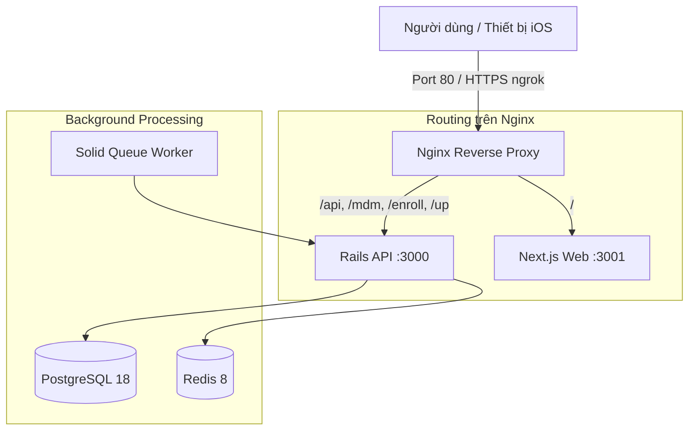

# 💻 Machine Runbook: MacBook Pro 2019 (T2) — 24/7 Ubuntu Server & Dev Workstation

Tài liệu này lưu trữ toàn bộ cấu hình chuẩn của chiếc máy hiện tại: **Apple MacBook Pro 15-inch 2019 (Chip T2, Model MacBookPro15,2)** chạy **Ubuntu Linux**.

Máy đảm nhiệm **vai trò kép (Dual-Role)**:
1. **24/7 Home Web Server:** Vận hành liên tục các ứng dụng web cho dự án **VN-MDM** (Backend Rails, Frontend Next.js, Solid Queue Worker, Nginx reverse proxy, ngrok HTTPS tunnel, PostgreSQL, Redis).
2. **Full-Stack Developer Workstation:** Môi trường làm việc đồ họa (Ubuntu Desktop Wayland) với đầy đủ IDE (Cursor, Warp, Antigravity), công cụ kiểm thử (Postman), Cloud/K8s CLI (Azure CLI, kubectl), và bộ gõ tiếng Việt IBus Bamboo.

---

## ⚡ 1-Click Khôi Phục Hoàn Toàn (Zero-Thought Restore)

Sau khi cài mới Ubuntu trên chiếc MacBook này, bạn chỉ cần mở Terminal và chạy duy nhất lệnh sau:

```bash
git clone https://github.com/hoquanganh/setup-mac-ubuntu.git ~/Documents/Ubuntu_install
cd ~/Documents/Ubuntu_install
sudo ./bin/restore_current_machine.sh
```

Script sẽ tự động hoàn tất 100% mọi thứ qua 9 bước:
1. **Phần cứng T2:** Cài kernel `linux-t2`, trích xuất firmware Wi-Fi/Bluetooth từ máy chủ Apple, kích hoạt bàn phím, trackpad chống nhảy chữ (tắt `tap-to-click`), kích hoạt `keyd` (gán Shift phải = Esc do Touch Bar hỏng), và bỏ qua card mạng ảo T2 (`ac:de:48:00:11:22`) để tránh thông báo lỗi "Connection failed" liên tục.
2. **Nguồn điện:** Chống sleep khi gập nắp máy (`HandleLidSwitch=ignore`, mask toàn bộ `sleep.target`, `suspend.target`).
3. **Cơ sở dữ liệu:** Cài đặt và cấu hình PostgreSQL (`vnmdm` / `vnmdm`) và Redis.
4. **Môi trường chạy:** Node.js 22, Ruby (rbenv), Docker.
5. **Mạng nội bộ:** Cài đặt `avahi-daemon` với tên miền `qa-MacBookPro15-2.local`.
6. **Mạng từ xa:** Cài đặt Tailscale và OpenSSH.
7. **Web Server & Firewall:** Cấu hình Nginx reverse proxy trên cổng 80 và mở UFW.
8. **Dự án VN-MDM:** Clone repo, cài đặt gem, build frontend, cài 4 dịch vụ systemd (`vnmdm-backend`, `vnmdm-worker`, `vnmdm-frontend`, `ngrok-vnmdm`).
9. **Desktop GUI & DevOps Tools:** Cài đặt Google Chrome, Cursor IDE, Warp Terminal, TablePlus, IBus Bamboo tiếng Việt, Azure CLI (`az`), `kubectl`, Postman, Sublime Text.

---

## 📦 Danh Mục Ứng Dụng Đã Cài Đặt & Hoạt Động Ổn Định

Bảng kiểm kê toàn bộ các ứng dụng, dịch vụ và công cụ đã được cài đặt và kiểm nghiệm hoạt động ổn định trên máy này:

### 1. Dịch Vụ Máy Chủ & Hạ Tầng (Background Daemons)
| Tên Dịch Vụ | Phiên Bản / Gói | Trạng Thái / Port | Mục Đích Sử Dụng |
|---|---|---|---|
| **Nginx** | 1.28.x (`nginx`) | Port 80 / 443 | Reverse proxy định tuyến Web UI, Rails API, và các dự án |
| **PostgreSQL** | 18.x (`postgresql-18`) | Port 5432 | Cơ sở dữ liệu chính cho VN-MDM và các ứng dụng Rails |
| **Redis** | 8.x (`redis-server`) | Port 6379 | Bộ đệm (cache) và hàng đợi background jobs |
| **OpenSSH** | Standard (`ssh`) | Port 22 | Quản trị từ xa an toàn qua terminal |
| **Avahi mDNS** | `avahi-daemon` | mDNS 5353 | Phân giải tên miền mạng LAN: `qa-MacBookPro15-2.local` |
| **Tailscale** | `tailscaled` | VPN Mesh | Kết nối an toàn từ xa không cần mở port modem |
| **ngrok** | 3.x (`/usr/local/bin/ngrok`) | HTTPS Tunnel | Public tunnel cố định cho thiết bị iOS thật ghi danh MDM |
| **keyd** | 2.5.x (`keyd.service`) | Kernel daemon | Gán phím **Shift phải = Esc** (khắc phục Touch Bar bị hỏng) |

### 2. Các Ứng Dụng Web Được Host Trên Máy (Hosted Web Apps)
| Ứng Dụng | Đường Dẫn Repo | Dịch Vụ / Port | Mô Tả |
|---|---|---|---|
| **VN-MDM Backend** | `~/vn-mdm/api` | `vnmdm-backend.service` (:3000) | Rails API xử lý nghiệp vụ MDM, APNs, ABM/ADE |
| **VN-MDM Frontend** | `~/vn-mdm/web` | `vnmdm-frontend.service` (:3001) | Next.js Web giao diện quản trị Admin |
| **VN-MDM Worker** | `~/vn-mdm/api` | `vnmdm-worker.service` | Solid Queue Worker đẩy lệnh APNs & xử lý nền |
| **VN-MDM Landing** | `~/vn-mdm-landing` | Astro framework | Trang landing page giới thiệu hệ sinh thái |
| **Server Apps Backend**| `~/server-apps/backend`| Standalone Node/Rails | Dịch vụ hỗ trợ nội bộ |

### 3. Môi Trường Ngôn Ngữ & Runtimes
| Ngôn Ngữ / Runtime | Phiên Bản | Công Cụ Quản Lý | Ghi Chú |
|---|---|---|---|
| **Node.js & npm** | Node.js 22.x LTS | NodeSource apt | Chạy Next.js frontend và các build tooling |
| **Ruby & Bundler** | Ruby 3.4.x / 3.3.x | `rbenv` (`~/.rbenv`) | Chạy backend Rails và gem native |
| **Python** | Python 3.14 | Hệ thống Ubuntu 26.04 | Chạy các script automation |

### 4. Ứng Dụng Desktop Đồ Họa (Developer GUI Apps)
| Ứng Dụng | Cách Cài Đặt / Đường Dẫn | Mục Đích |
|---|---|---|
| **Cursor IDE** | AppImage (`~/Applications/cursor/cursor`), lệnh `cursor` | Trình soạn thảo mã nguồn tích hợp AI chính |
| **Google Chrome** | Deb chính hãng (`google-chrome-stable`) | Trình duyệt web chính, hỗ trợ test và headless automation |
| **Warp Terminal** | Repo chính hãng (`warp-terminal`) | Terminal AI thế hệ mới với block workflows |
| **Antigravity IDE & agy CLI** | Tích hợp (`~/Applications/antigravity-ide/`, `~/.local/bin/agy`) | Môi trường lập trình nâng cao với AI pair-programmer |
| **Postman** | Snap (`snap install postman`) | Kiểm thử REST API và các webhook MDM |
| **Sublime Text** | Snap Classic (`snap install --classic sublime-text`) | Trình soạn thảo văn bản nhẹ cho file log/config |
| **TablePlus** | AppImage (`~/Documents/Systems/install-packs/`) | GUI trực quan quản lý PostgreSQL, Redis, MySQL |
| **IBus Bamboo** | PPA (`bamboo-engine/ibus-bamboo`) | Bộ gõ tiếng Việt Telex/VNI hoạt động mượt trên Wayland |

### 5. Công Cụ Cloud, DevOps & CLI
| Công Cụ | Lệnh Kiểm Tra | Mô Tả |
|---|---|---|
| **Azure CLI** | `az --version` | Quản trị tài nguyên Microsoft Azure, AKS |
| **Kubernetes CLI** | `kubectl version --client` | Điều khiển cụm Kubernetes cluster |
| **GitHub CLI** | `gh --version` | Thao tác Pull Request, Repo qua terminal |
| **Claude Code CLI** | `claude --version` | Trợ lý dòng lệnh thông minh Claude Code |
| **Zsh & Oh My Zsh** | `zsh --version` | Shell tương tác mặc định cho user `qa` |
| **Vim** | `vim --version` | Trình biên tập terminal tiêu chuẩn |

---

## 🌐 Thông Tin Truy Cập Máy Hiện Tại

- **WiFi nội bộ (LAN):**
  - Website: `http://qa-MacBookPro15-2.local` hoặc `http://172.26.25.62`
  - SSH: `ssh qa@qa-MacBookPro15-2.local`
- **Mạng riêng Tailscale (VPN):**
  - IP ảo: `http://100.x.y.z`
  - SSH: `ssh qa@100.x.y.z`
- **Công khai qua ngrok (Internet / Thiết bị di động bên ngoài):**
  - URL HTTPS tự động cập nhật qua dịch vụ `ngrok-vnmdm.service`.

---

## 🏗️ Kiến Trúc Dịch Vụ Hệ Thống



---

## 🛠️ Lệnh Quản Lý Dịch Vụ Hàng Ngày

```bash
# Kiểm tra trạng thái toàn bộ dịch vụ server
sudo systemctl status nginx postgresql redis-server vnmdm-backend vnmdm-worker vnmdm-frontend ngrok-vnmdm keyd

# Xem logs trực tiếp
journalctl -u vnmdm-backend -f
journalctl -u vnmdm-worker -f
journalctl -u vnmdm-frontend -f
journalctl -u ngrok-vnmdm -f

# Khởi động lại dịch vụ khi cập nhật code
sudo systemctl restart vnmdm-backend
sudo systemctl restart vnmdm-frontend
```

---

## 🔧 Xử Lý Sự Cố Phần Cứng Đặc Thù (MacBook Pro 2019 T2)

Tài liệu này lưu trữ toàn bộ các sự cố và giải pháp đã được kiểm nghiệm thực tế trên chính chiếc máy **MacBook Pro 15,2 (T2)** này:

### 1. Touch Bar Bị Hỏng Phần Cứng → Gán Phím Esc Bằng `keyd` (Shift Phải = Esc)
* **Đặc thù phần cứng:** Dải OLED Touch Bar của máy bị hỏng hoàn toàn (không sáng, không phản hồi). Dòng MacBook Pro 2018–2019 không có phím `Esc` vật lý, nên khi Touch Bar hỏng sẽ **mất hoàn toàn phím Escape** (rất bất tiện trong Terminal, Vim, hủy tiến trình).
* **Giải pháp chuẩn:** Hệ thống sử dụng daemon `keyd` để gán phím **Right Shift (Shift phải)** thành phím **Escape (`Esc`)**:
  ```bash
  sudo apt install -y keyd
  sudo mkdir -p /etc/keyd
  sudo tee /etc/keyd/default.conf <<'EOF'
  [ids]
  *

  [main]
  rightshift = escape
  EOF
  sudo systemctl daemon-reload
  sudo systemctl enable --now keyd
  ```
  *(Script `hardware/t2-mac/install_t2_drivers.sh` đã tự động hóa việc này khi restore).*

### 2. Gõ Bàn Phím Bị Nhảy Chữ / Con Trỏ Chuột Tự Nhảy → Tắt `tap-to-click`
* **Nguyên nhân:** Mặt Trackpad của MacBook Pro rất lớn. Khi gõ phím, lòng bàn tay quẹt nhẹ qua mặt kính. Tính năng `tap-to-click` kích hoạt click chuột ngẫu nhiên làm nhảy con trỏ soạn thảo sang vị trí khác; đồng thời `keyd virtual keyboard` vô hiệu hóa tính năng tự ngắt trackpad khi gõ (*Disable-While-Typing*).
* **Giải pháp chuẩn (Không dùng tap-to-click):**
  ```bash
  # Tắt vĩnh viễn tính năng chạm nhẹ để click
  gsettings set org.gnome.desktop.peripherals.touchpad tap-to-click false

  # Cho phép trackpad hoạt động bình thường (song song cùng chuột ngoài)
  gsettings set org.gnome.desktop.peripherals.touchpad send-events 'enabled'
  ```
  *(Trackpad vẫn rê chuột và click vật lý bằng cách ấn lún bàn rê xuống bình thường, nhưng lòng bàn tay chạm nhẹ khi gõ sẽ 100% không bị click làm nhảy chữ).*

### 3. Mất Wi-Fi & Bluetooth Sau Khi Cài Mới Ubuntu
* **Nguyên nhân:** Card mạng Broadcom trên chip T2 yêu cầu firmware độc quyền của Apple, Ubuntu gốc không đi kèm firmware này.
* **Cách khắc phục:**
  1. Kết nối internet tạm thời qua USB Tethering từ điện thoại (hoặc cắm USB Wi-Fi rời).
  2. Chạy lệnh trích xuất firmware chính hãng:
     ```bash
     sudo get-apple-firmware get_from_online
     ```
  3. Khởi động lại máy: `sudo reboot`.

### 4. Bàn Phím & Trackpad Không Nhận Sau Khi Cài Ubuntu Mặc Định
* **Nguyên nhân:** Kernel mặc định của Ubuntu thiếu driver giao tiếp với chip bảo mật Apple T2.
* **Cách khắc phục:**
  1. Cài đặt kernel `linux-t2`:
     ```bash
     sudo bash hardware/t2-mac/install_t2_drivers.sh
     ```
  2. Khởi động lại máy vào kernel T2:
     ```bash
     sudo reboot
     ```
